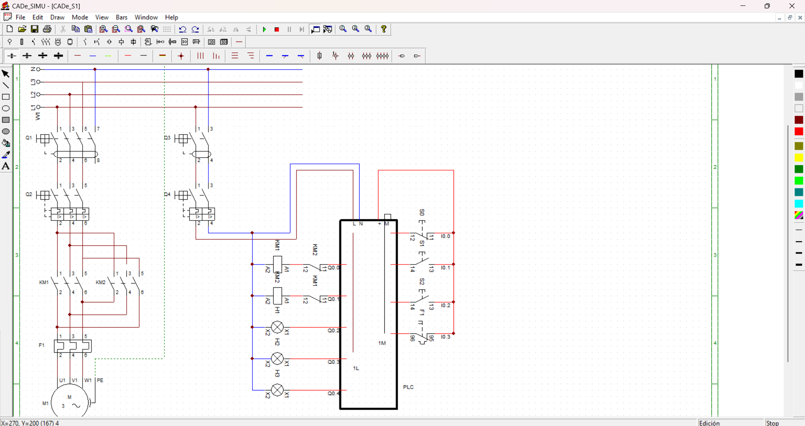
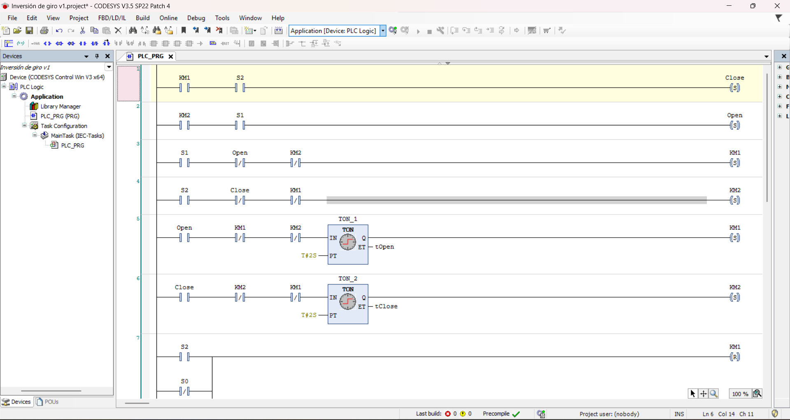
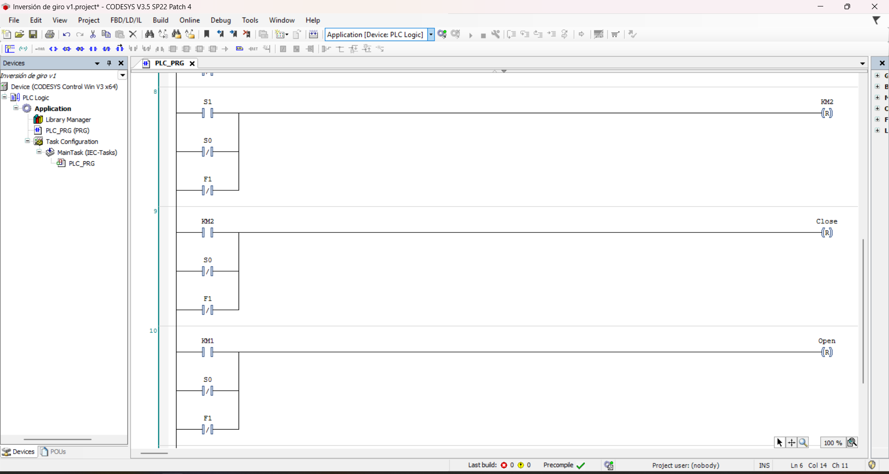
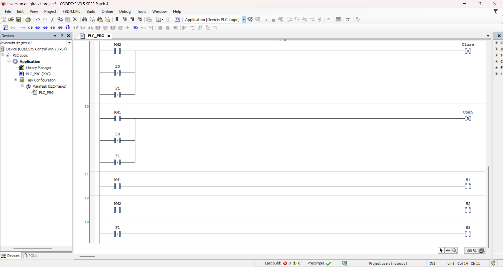
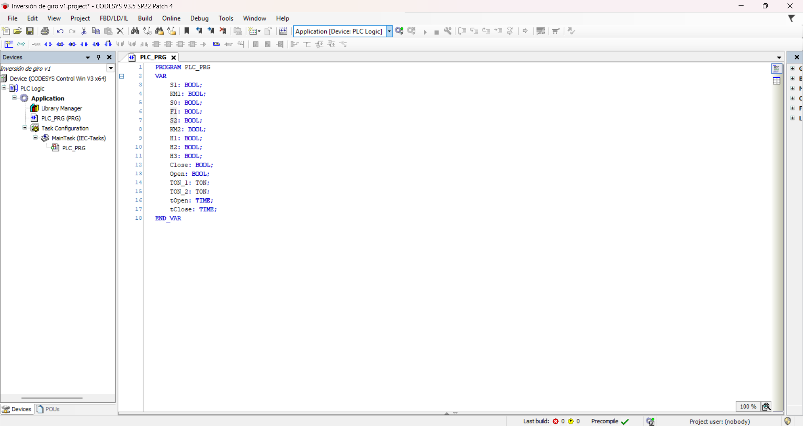
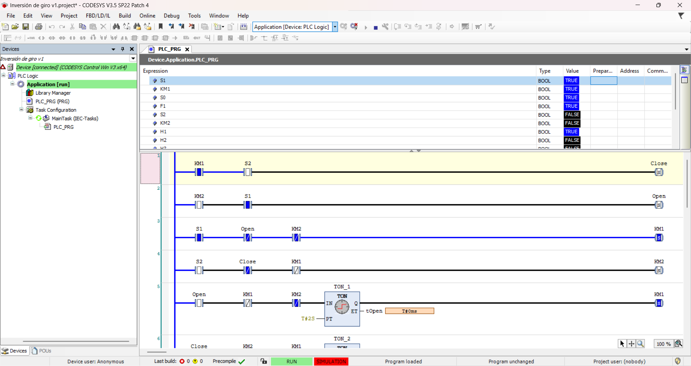
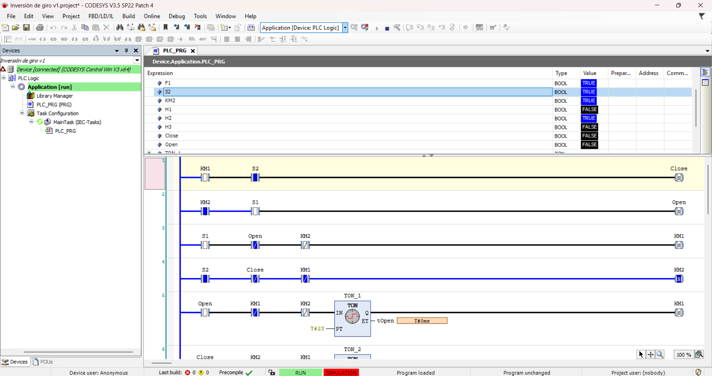
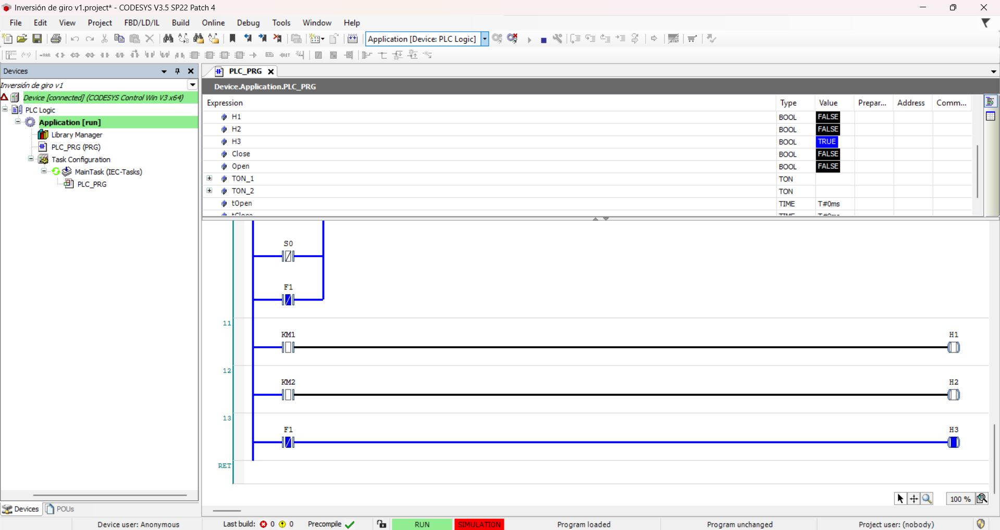

# 02 – Reversing a sliding door motor

## Scenario
A motorised sliding door at the entrance of a warehouse. The motor turns in one direction to open and in the other to close.

## I/O table

| Symbol | Description | Type | Address |
|---|---|---|---|
| S0 | Stop push button | Input, NC | I0.0 (%IX0.0) |
| S1 | "Open" push button | Input, NO | I0.1 (%IX0.1) |
| S2 | "Close" push button | Input, NO | I0.2 (%IX0.2) |
| F1 | Overload relay auxiliary contact (95-96) | Input, NC | I0.3 (%IX0.3) |
| KM1 | Contactor – opening direction | Output | Q0.0 (%QX0.0) |
| KM2 | Contactor – closing direction | Output | Q0.1 (%QX0.1) |
| H1 | Pilot light "opening" | Output | Q0.2 (%QX0.2) |
| H2 | Pilot light "closing" | Output | Q0.3 (%QX0.3) |
| H3 | Pilot light "overload tripped" | Output | Q0.4 (%QX0.4) |
| Open, Close | Memory bits: direction change request | Internal | – |
| TON_1, TON_2 | TON timers (2 s pause before reversing) | Internal | – |

## How it works
- From standstill, **S1** starts opening (KM1) and **S2** starts closing (KM2). Both are latched with **SET/RESET coils**.
- **S0** or a tripped overload **F1** stops the motor at any time.
- **Software interlock:** KM1 and KM2 can never be on at the same time.
- **Hardwired interlock:** an NC auxiliary contact of KM2 is wired in series with the KM1 coil, and vice versa, so both contactors can never close together even if the PLC fails.
- **Extension B – direct reversing with a pause:** if the door is opening and S2 is pressed, KM1 stops immediately, the request is stored in the memory bit `Close`, the motor stays stopped for **2 s** and then KM2 starts automatically. The same happens in the other direction with S1 and `Open`.
- Network order matters: request SETs first, then motor SETs (including timers), then all RESETs, so stop always has priority.

## Files
- `02-reversing.project.project` – CODESYS project

### PLC wiring diagram

### Program
Networks 1–7:

Networks 8–10:

Networks 10–13:

### Variables

### Running: opening (KM1)

### Running: closing (KM2)

### Overload tripped (F1)

## Test table

| # | Action | Expected result | OK |
|---|---|---|---|
| 1 | Start (S0 = TRUE, F1 = TRUE) | Everything off |  |
| 2 | S2 pressed and released from standstill | KM2 on immediately, H2 on |  |
| 3 | KM2 running, S1 pressed and released | KM2 off at once, 2 s pause, then KM1 on |  |
| 4 | KM1 running, S2 pressed and released | KM1 off at once, 2 s pause, then KM2 on |  |
| 5 | S0 pressed during the 2 s pause | Nothing starts, requests cleared |  |
| 6 | F1 → FALSE while running | Motor stops, H3 on |  |
| 7 | Any test | KM1 and KM2 never on at the same time |  |

## Extension C (to do)
Limit switches B1 (door fully open) and B2 (door fully closed).
