# 02 – Reversing a sliding door motor

## Scenario
A motorised sliding door at the entrance of a warehouse. The motor turns in one direction to open and in the other to close. Limit switches stop the door at both ends.

## I/O table

| Symbol | Description | Type | Address |
|---|---|---|---|
| S0 | Stop push button | Input, NC | I0.0 (%IX0.0) |
| S1 | "Open" push button | Input, NO | I0.1 (%IX0.1) |
| S2 | "Close" push button | Input, NO | I0.2 (%IX0.2) |
| F1 | Overload relay auxiliary contact (95-96) | Input, NC | I0.3 (%IX0.3) |
| FC1 | Limit switch "door fully open" | Input, NC | I0.4 (%IX0.4) |
| FC2 | Limit switch "door fully closed" | Input, NC | I0.5 (%IX0.5) |
| S3 | Fault reset push button | Input, NO | I0.6 (%IX0.6) |
| KM1 | Contactor – opening direction | Output | Q0.0 (%QX0.0) |
| KM2 | Contactor – closing direction | Output | Q0.1 (%QX0.1) |
| H1 | Pilot light "opening" | Output | Q0.2 (%QX0.2) |
| H2 | Pilot light "closing" | Output | Q0.3 (%QX0.3) |
| H3 | Pilot light "overload tripped" | Output | Q0.4 (%QX0.4) |
| H4 | Pilot light "sensor fault" (blinking) | Output | Q0.5 (%QX0.5) |
| Open, Close | Memory bits: direction change request | Internal | – |
| Fault | Memory bit: limit switch fault | Internal | – |
| TON_1, TON_2 | 2 s pause before reversing | Internal | – |
| TON_3, TON_4 | Blinking oscillator for H4 (1 s / 1 s) | Internal | – |

## How it works
- From standstill, **S1** opens (KM1) and **S2** closes (KM2). Motors are latched with **SET/RESET coils**.
- **S0** or a tripped overload **F1** stops the motor at any time.
- **Software interlock:** KM1 and KM2 can never be on at the same time.
- **Extension B – direct reversing with a pause:** if the door is moving and the opposite button is pressed, the motor stops immediately, the request is stored (`Open` / `Close`), the motor stays stopped for **2 s** and then starts in the other direction.
- **Extension C – limit switches:** FC1 and FC2 are wired **NC** (fail-safe: TRUE while the door has not reached the end). When the door reaches an end, the switch opens, the motor stops and it cannot start again towards that end.
- **Sensor fault detection:** FC1 and FC2 can never be FALSE at the same time (the door cannot be fully open and fully closed). If it happens (broken wire or faulty sensor), the fault is **latched**, both motors are blocked and **H4 blinks**. The fault can only be reset with **S3** once at least one sensor is healthy again.
- **Hardwired safety:** NC auxiliary contacts interlock KM1/KM2, and each limit switch is also wired in series with its contactor coil, so the door stops even if the PLC fails.
- Network order: SETs first, then all RESETs, so stop and faults always have priority.

## Files
- `02-reversing.project` – CODESYS project

### PLC wiring diagram
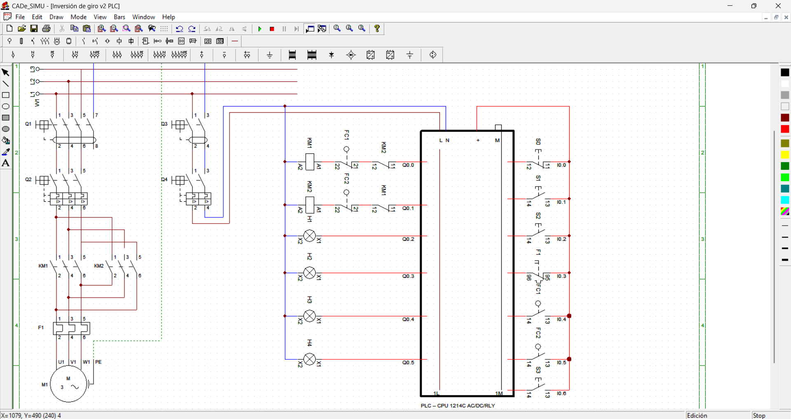

### Program
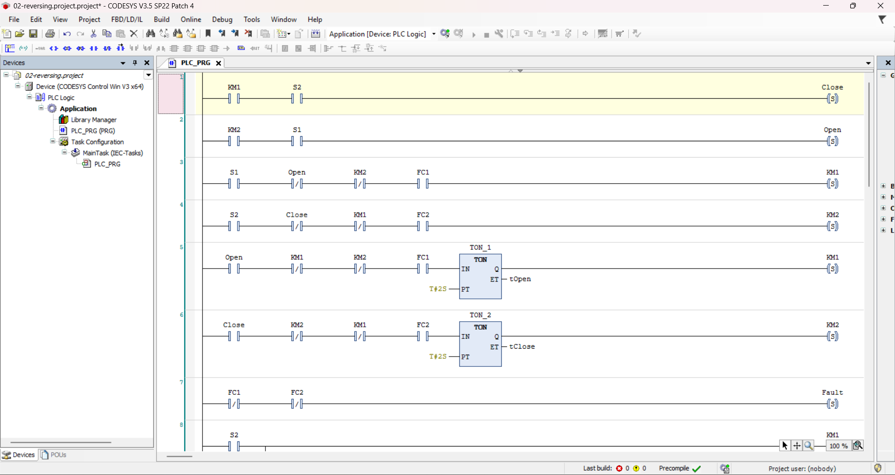
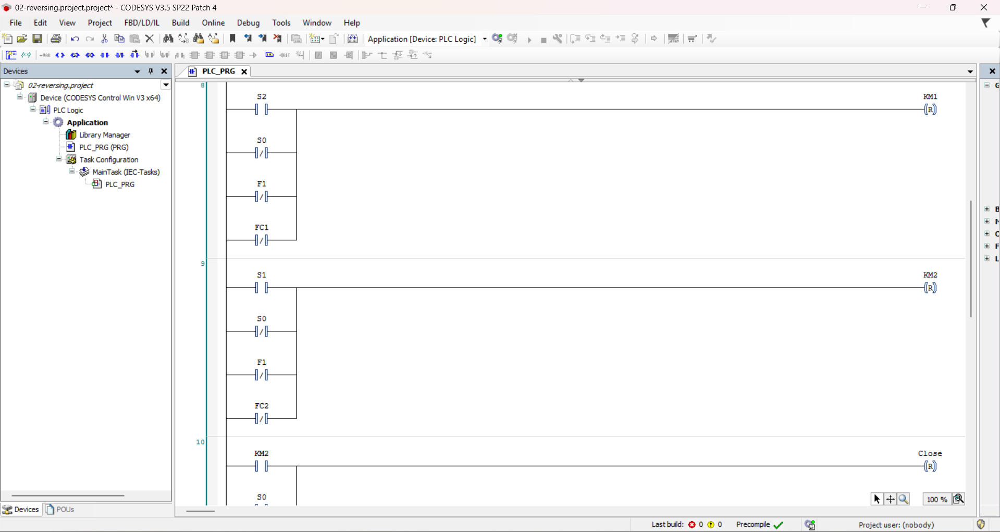
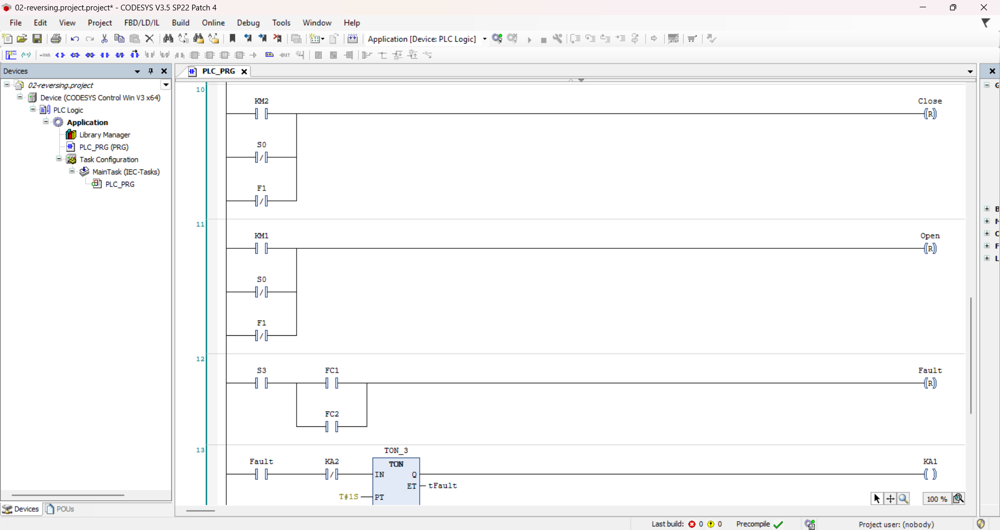
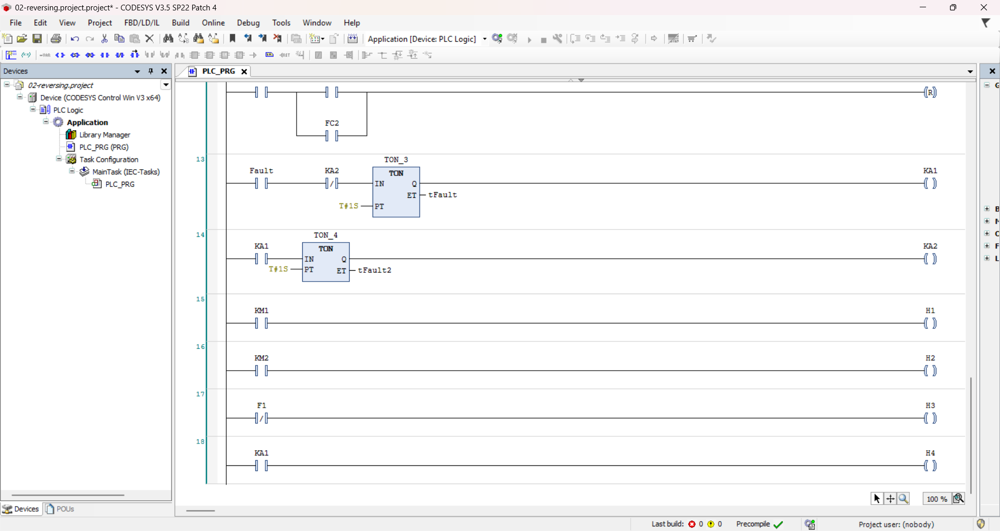

### Variables
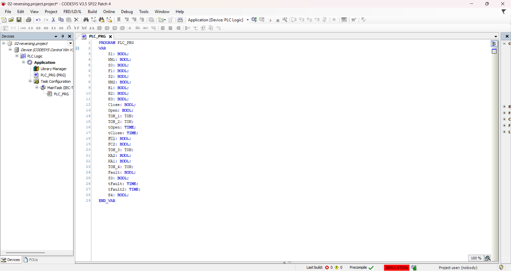

### Opening (KM1)
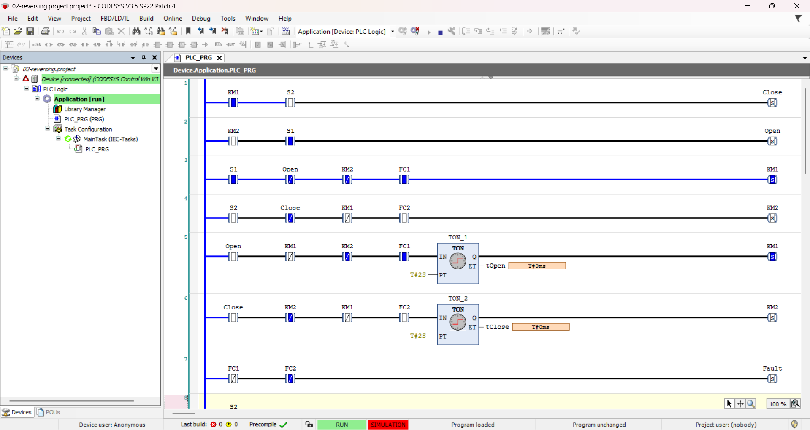

### Closing (KM2)
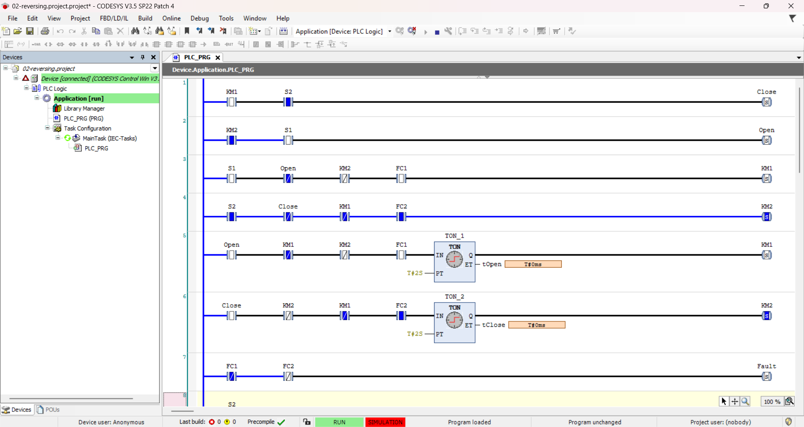

### Overload tripped (F1)
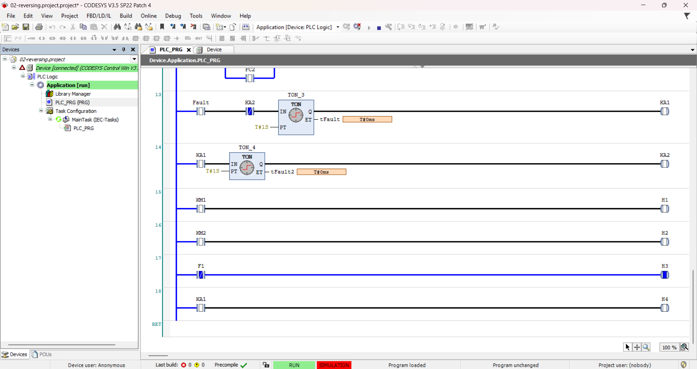

### Stopped by limit switch (FC1)
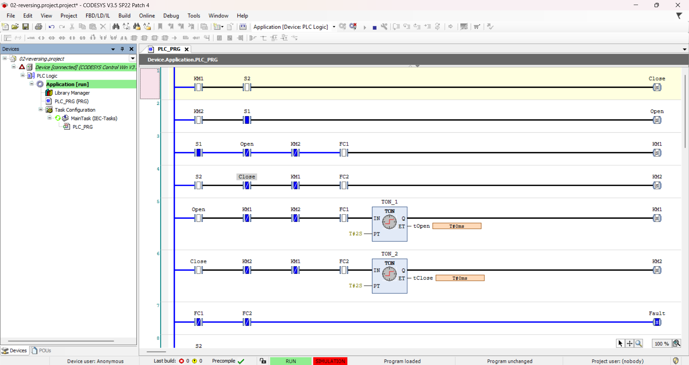

### Sensor fault (FC1 and FC2 FALSE, H4 blinking)
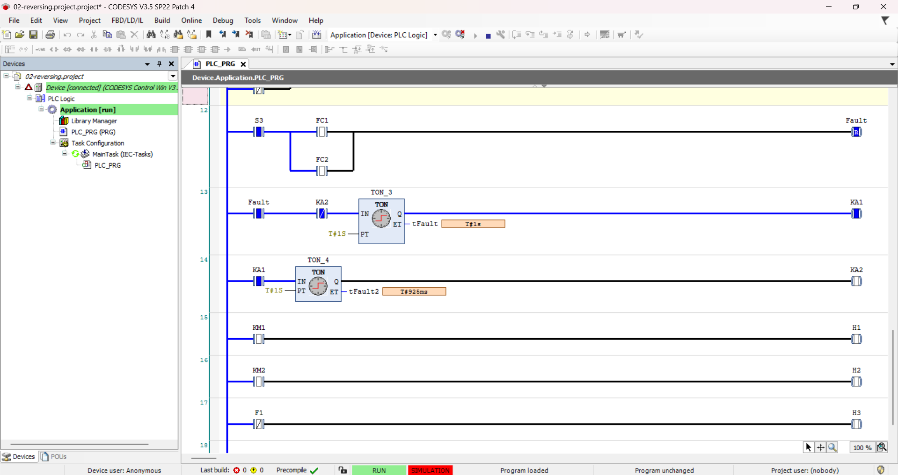

## Test table

| # | Action | Expected result | OK |
|---|---|---|---|
| 1 | Start (S0, F1, FC1, FC2 = TRUE) | Everything off |  |
| 2 | S1 pressed | KM1 on, H1 on |  |
| 3 | FC1 → FALSE (door fully open) | KM1 off |  |
| 4 | FC1 = FALSE, S1 pressed | Nothing happens |  |
| 5 | S2 pressed, then FC2 → FALSE | KM2 runs, then stops at the end |  |
| 6 | Door moving, opposite button pressed | Motor stops, 2 s pause, other direction starts |  |
| 7 | S0 pressed during the pause | Nothing starts |  |
| 8 | F1 → FALSE while running | Motor stops, H3 on |  |
| 9 | FC1 and FC2 FALSE at the same time | Fault: motors blocked, H4 blinks |  |
| 10 | FC1 back to TRUE | H4 keeps blinking (fault latched) |  |
| 11 | S3 pressed with a healthy sensor | Fault reset, H4 off |  |
| 12 | S3 pressed with FC1 and FC2 still FALSE | Fault stays |  |
| 13 | Any test | KM1 and KM2 never on at the same time |  |

## Versions
- v1 – basic reversing with SET/RESET and interlocking (included in v2)
- v2 – extension B: direct reversing with 2 s pause
- v3 – extension C: limit switches + sensor fault detection with latched alarm and reset
