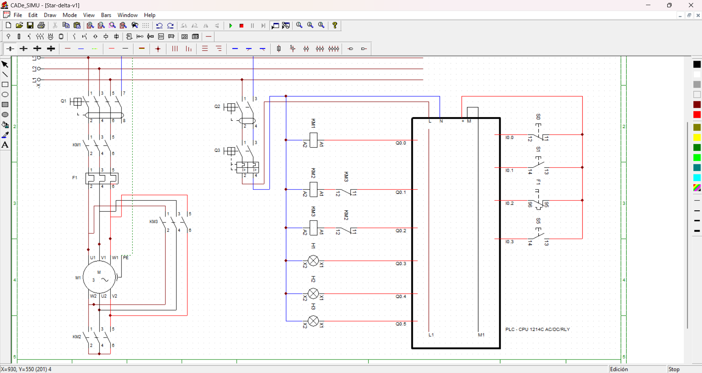
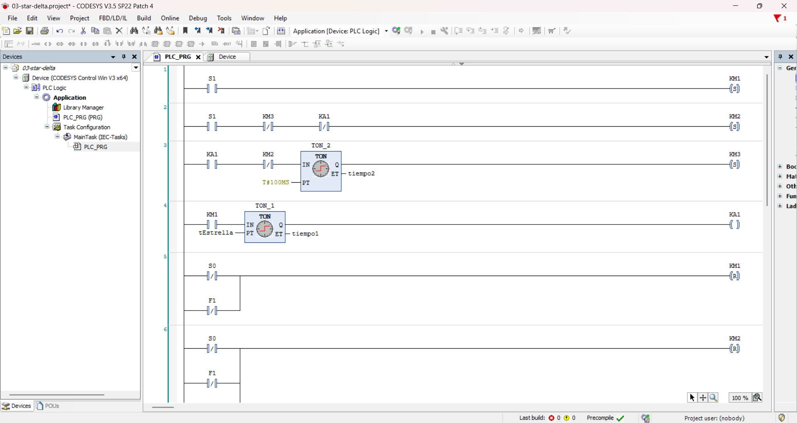
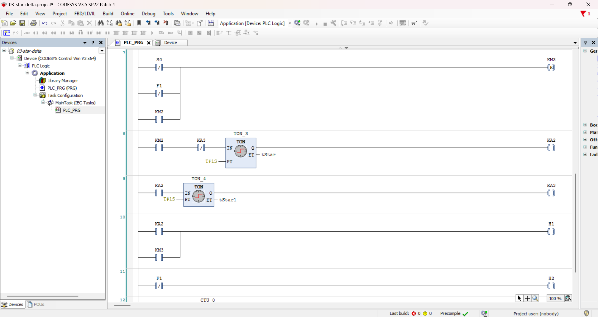
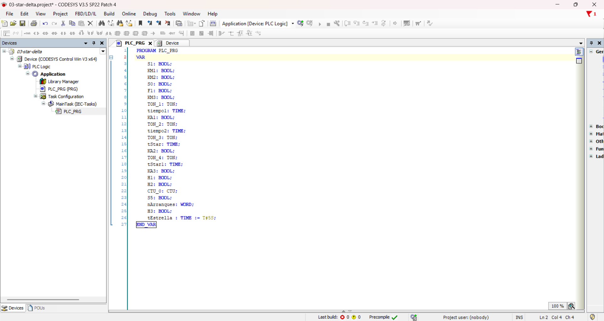
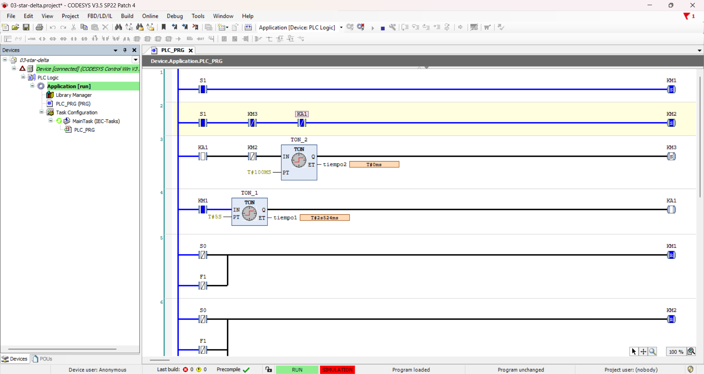
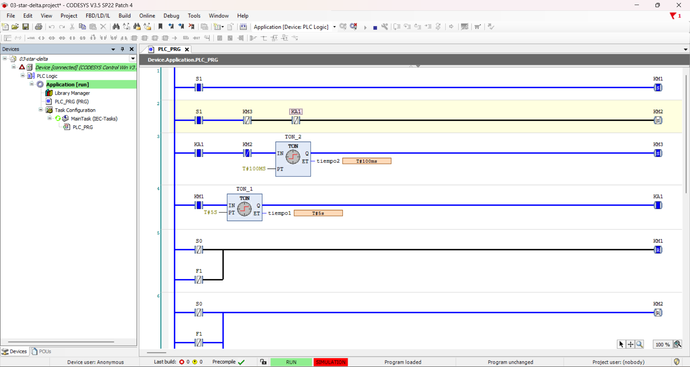
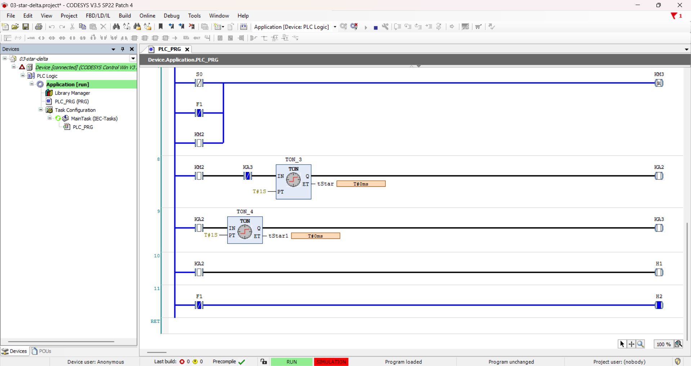
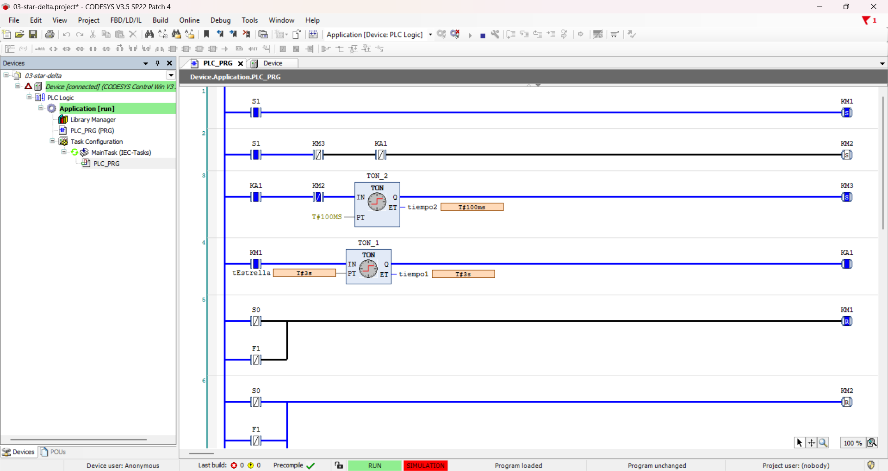
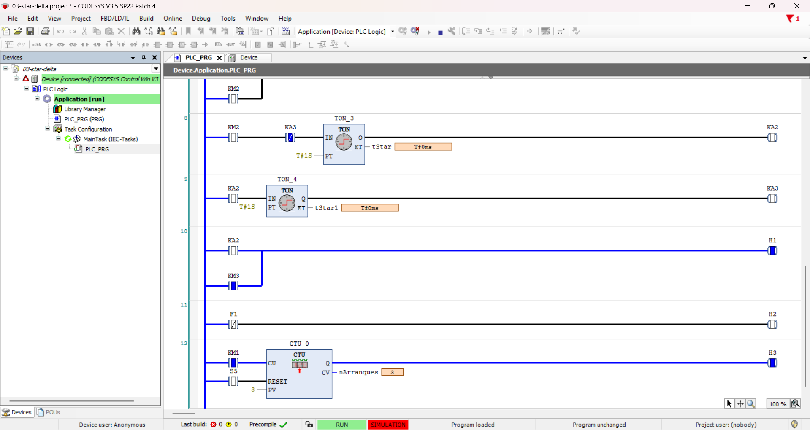

# 03 – Star-delta start of a compressor

## Scenario
A 15 kW air compressor in a workshop. To limit the starting current, the motor starts in **star** and switches to **delta** once it has picked up speed.

## I/O table

| Symbol | Description | Type | Address |
|---|---|---|---|
| S0 | Stop push button | Input, NC | I0.0 (%IX0.0) |
| S1 | Start push button | Input, NO | I0.1 (%IX0.1) |
| F1 | Overload relay auxiliary contact (95-96) | Input, NC | I0.2 (%IX0.2) |
| KM1 | Line contactor | Output | Q0.0 (%QX0.0) |
| KM2 | Star contactor | Output | Q0.1 (%QX0.1) |
| KM3 | Delta contactor | Output | Q0.2 (%QX0.2) |
| H1 | Pilot light "running" (blinking in star, steady in delta) | Output | Q0.3 (%QX0.3) |
| H2 | Pilot light "overload tripped" | Output | Q0.4 (%QX0.4) |
| S5 | Maintenance reset push button | Input, NO | I0.3 (%IX0.3) |
| H3 | Pilot light "service due" | Output | Q0.5 (%QX0.5) |
| TON_1 → KA1 | Star time (`tEstrella`, default 5 s), timed from KM1 | Internal | – |
| TON_2 | 100 ms pause between star and delta | Internal | – |
| TON_3, TON_4 → KA2, KA3 | Blinking oscillator for H1 (1 s / 1 s) | Internal | – |
| tEstrella | Star time parameter: `TIME := T#5S` | Internal | – |
| CTU_0 → nArranques | Start counter (CV, `WORD`), preset 50 | Internal | – |

## How it works
- **S1** starts the motor in star: **KM1 + KM2** on. Contactors are latched with **SET/RESET coils**.
- After **5 s**, KM2 switches off. The PLC waits **100 ms** with KM2 and KM3 both off (so the arc in the contacts dies out) and then switches **KM3** on. The motor keeps running in delta: **KM1 + KM3**.
- **S0** or a tripped overload **F1** stops everything at any moment, also in the middle of the start sequence. H2 lights up when F1 trips.
- **H1** blinks during the star phase and stays on in delta.
- **Software interlock:** KM2 and KM3 can never be on at the same time.
- **Key design decision:** the star timer (TON_1) is driven by **KM1**, not by KM2. If it were driven by KM2, switching KM2 off at the end of the star phase would reset the timer and KM3 would never start. KM1 stays on during the whole start, so the sequence keeps going.
- **S1 held down:** the SET of KM2 also needs `/KA1`. Without it, if the operator keeps S1 pressed for more than 5 s, KM2 is set again in every scan, the 100 ms timer never sees KM2 off and delta never starts.
- Network order: SETs first, then all RESETs, so stop and overload always have priority.

### Extension
- **Adjustable star time:** the PT of TON_1 reads the variable `tEstrella : TIME := T#5S;` instead of a fixed `T#5S`. The star time can be changed online (or from an HMI) without editing or downloading the program.
- **Start counter for maintenance:** a CTU counts every rising edge of **KM1** (one start = one KM1 activation). Counting KM1 instead of S1 means extra presses while running or with the overload tripped are not counted. After **50 starts**, **H3** "service due" lights up and stays on until the maintenance button **S5** resets the counter.
- Why starts and not hours: every start is the moment of highest wear (inrush current, arcing in the contacts, mechanical stress).
- **Design choice:** H3 only warns, it does not block the compressor. Preventive maintenance is a decision for a person, not a reason to stop the workshop. Possible improvement: warn at 50 starts and block new starts at 55 if nobody has done the service (`S1 · /Block → (S) KM1`).
- In a real PLC the counter should be declared in `VAR RETAIN` so the count is not lost after a power cut.

## Wiring
- **Power circuit:** Q1 → KM1 → F1 → U1-V1-W1. KM3 connects U1-W2, V1-U2, W1-V2 (delta). KM2 joins U2-V2-W2 (star point).
- **Control circuit:** protected by a circuit breaker (Q2) and an RCD (Q3). Contactor coils and pilot lights are connected between the PLC relay outputs and neutral.
- **Hardwired interlock:** NC auxiliary contact of KM3 in series with the KM2 coil, and NC of KM2 in series with the KM3 coil. Even if the PLC fails, star and delta can never close together (that would be a phase-to-phase short circuit).
- Stop button and overload contact are wired **NC** (fail-safe).

## Files
- `03-star-delta.project` – CODESYS project

### Wiring diagram (power + PLC)

### Program

### Variables

### Star (KM1 + KM2, H1 blinking)

### Delta (KM1 + KM3, H1 steady)

### Overload tripped (F1)

### Star time changed online (`tEstrella` = 3 s)

### Start counter (PV temporarily set to 3 for testing, H3 on)

## Test table

| # | Action | Expected result | OK |
|---|---|---|---|
| 1 | Start (S0, F1 = TRUE) | Everything off | |
| 2 | S1 pressed | KM1 + KM2 on, H1 blinking | |
| 3 | 5 s later | KM2 off → 100 ms pause → KM3 on, H1 steady | |
| 4 | S1 pressed while running in delta | Nothing changes (KM2 does not start) | |
| 4b | S1 held down for more than 5 s | Star → delta transition still happens normally | |
| 5 | S0 pressed during star | Everything off | |
| 6 | S1 pressed again after a stop | The sequence starts again from star (full 5 s) | |
| 7 | S0 pressed during delta | Everything off | |
| 8 | F1 → FALSE while running | Everything off, H2 on | |
| 9 | F1 still FALSE, S1 pressed | Nothing starts | |
| 10 | Any test | KM2 and KM3 never on at the same time | |
| 11 | `tEstrella` changed to T#3S online | Star phase lasts 3 s | |
| 12 | Several starts | `nArranques` increases by 1 per start | |
| 13 | S1 pressed while running | `nArranques` does not change | |
| 14 | Counter reaches PV | H3 on, compressor keeps working | |
| 15 | S5 pressed | Counter back to 0, H3 off | |

## Versions
- v1 – basic star-delta start with SET/RESET, 100 ms pause and interlocking (software + hardware)
- v2 – extension: adjustable star time (`tEstrella`) and start counter with service light (CTU)
